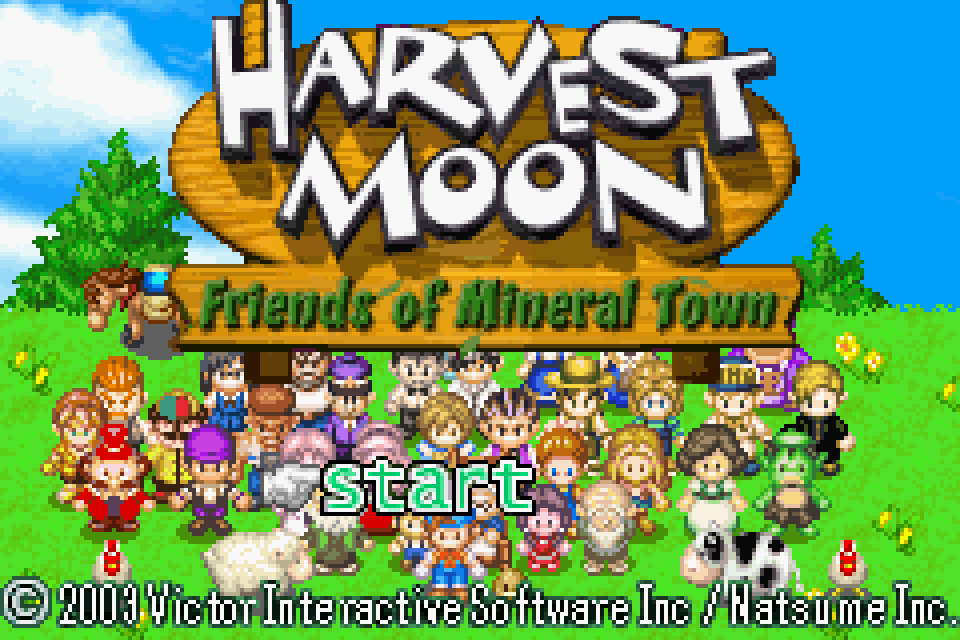
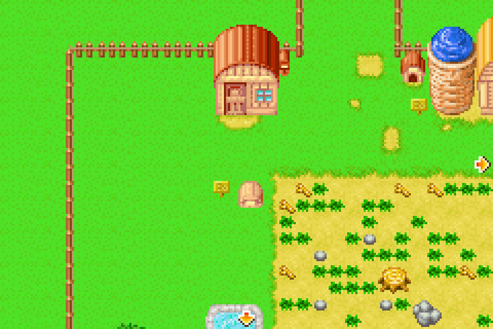
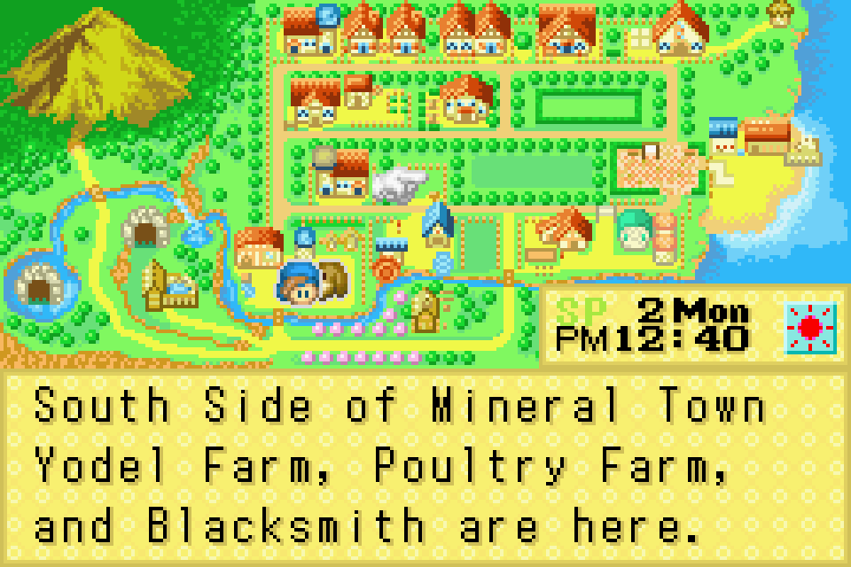
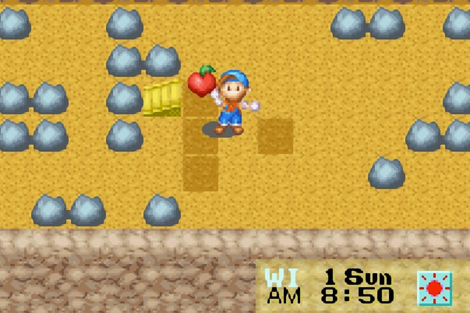

# Harvest Moon: Friends of Mineral Town — Android (native port)

A native Android port of the 2003 Game Boy Advance game *Harvest Moon:
Friends of Mineral Town* (US), built by static recompilation with
[mstan/gbarecomp](https://github.com/mstan/gbarecomp). The ROM's ARM/Thumb
machine code is translated once into native C++ and linked against a
shared GBA hardware runtime. No emulator core, no interpreter at runtime,
no shipped `.gba` ROM.

Gameplay from the original Game Boy Advance release (2003). These are not
screenshots of this port — it has none yet; the desktop build has only run
headless so far.

| | |
| --- | --- |
| <br>Title screen | <br>The farm |
| <br>Mineral Town map | <br>Mining for a Power Berry |

## Hard constraint

**Native port only.** The shipped build must pass `GBARECOMP_STRICT_STATIC=1`
on desktop first (`COVERAGE: FULLY_STATIC`, zero interpreted instructions,
zero dispatch misses). On Android there is no toolchain, so any coverage
hole would fall back to the interpreter bridge — that is not a shippable
state, however loudly it is logged.

## What this is

The game code itself is recompiled to run natively on ARM64. The gbarecomp
runtime underneath models the GBA hardware: tile and bitmap video, sprites,
palettes, blending, DMA, timers, interrupts, audio (the game's own m4a
engine, recompiled — not reimplemented), and SRAM saves. The player's ROM
file stays the data source at runtime; it is loaded behind the runtime's
bus, never embedded in the build.

## Status (2026-11-22)

- PRs #1–#10 merged: the regen pipeline, the desktop shell, and eight
  strict-static hint PRs (`game.toml` now carries 1 `[[code_copy]]`,
  6 `[[extra_func]]`, 2 `[[resume_range]]`).
- The desktop build works. The first translation run found 1,107
  functions. The BIOS is recompiled and the real intro runs under LLE.
- The strict-static burndown is in progress on desktop. The current step
  is one long non-strict coverage run to collect the remaining misses
  into a single batch of hints, instead of one PR per miss.
- Known runtime gaps, separate from the burndown: mosaic is unimplemented
  in the PPU; the mid-frame raster split still needs verification; the
  SRAM routines copy themselves onto the stack at a moving address; SWI
  0x2A is unproven.
- No release, no APK, no device testing yet. Android packaging comes
  after desktop `FULLY_STATIC` (see `LAYOUT.md`).

Full record: `docs/PROBE.md`.

## What you need (your own dumps — never download these)

- Harvest Moon: Friends of Mineral Town (USA), SHA-1
  `a2fc3574f0a65a4fcf7682fb274b9d7eebdef963`.
- A GBA BIOS dump (required even with BIOS HLE on).

The ROM, BIOS dump, and generated C++ are **never redistributed**: each
builder regenerates them from their own dump. The public APK will contain
no ROM/BIOS — the player supplies both at first-run setup (SHA-1/size
verified).

## Build

0. Upstream sanity (Windows): MSYS2 + devkitARM + `notyourav/agbcc`
   branch `cp`; place your ROM as `baserom.gba` in a StanHash/fomt
   checkout; `make compare` → OK. A fail here does NOT block the port —
   it just means finder-only mode (no decomp symbols).
1. `tools/fetch-upstream.sh` — pins gbarecomp + fomt.
2. `tools/regen.sh --rom <your ROM>` — ROM gate → stamp identity →
   decomp build + md5 (if step 0 passed) → symbol import → `gba_recompile`
   → `variants/fomt/generated/`.
3. Desktop build + strict-static run (see `docs/PROBE.md` §9):
   ```
   cmake -S . -B build-desktop -DCMAKE_BUILD_TYPE=Release
   cmake --build build-desktop -j4
   GBARECOMP_STRICT_STATIC=1 ./build-desktop/FoMTRecomp --no-window --frames 3600
   ```
   A pass prints `COVERAGE: FULLY_STATIC`. Under strict-static the run
   aborts on the first miss and the stderr line names the missing PC —
   add it as a `[[extra_func]]` / `[[resume_range]]` hint in
   `variants/fomt/game.toml`, re-run `tools/regen.sh`, rebuild, re-run.
   A run *without* the strict flag keeps going through misses and collects
   them all into `recomp_master_misses_A4NE.toml.frag` — the batch route.
   Run from the repo root (game.toml paths resolve relative to the TOML
   file). SDL2 is optional for the headless run; install it for a window
   (MSYS2: `mingw-w64-x86_64-SDL2`).
4. Android packaging comes after desktop `FULLY_STATIC`, following the
   Wario Land 4 shape in `docs/PROBE.md` §7 (Gradle, first-run setup flow
   where the player supplies their own ROM/BIOS).

## Project layout

```
Harvest-Moon-Friends-of-Mineral-Town-Android/
  README.md                # this file
  LAYOUT.md                # repo layout, phasing, what was replaced
  docs/PROBE.md            # gbarecomp probe write-up (the full record)
  docs/screenshots/        # original GBA release screenshots (above)
  gbarecomp/               # pinned SUBMODULE (PolyForm Noncommercial 1.0.0)
  tools/
    fetch-upstream.sh      # pins: gbarecomp rev + fomt b8471ae06
    regen.sh               # ROM gate → stamp → decomp+md5 → symbols → recompile
  variants/fomt/
    game.toml              # entry seeds, [[extra_func]], [[data_range]],
                           # [[jump_table]], [[code_copy]], [save], [bios]
    generated/             # gitignored build output, NEVER committed
  src/
    main.cpp               # desktop shell
    fomt_rom_identity.h    # regen-generated (SHA-1/CRC32)
  .gitignore               # ROMs, BIOS, generated/, saves, third_party/
```

## License

- The gbarecomp engine is **PolyForm Noncommercial 1.0.0** (+
  `PERMISSIONS.md`): free releases only — donations and ads are OK, but
  no paid APK, subscriptions, paid early access, or paid content. The
  `LICENSE` + `PERMISSIONS.md` statements must travel with the code. No
  sublicensing. Commercial use needs a separate licence from the engine
  author. Two engine files (`bios_hle`) are MPL-2.0.
- This repo's own code (shell, configs, scripts, patches) has no licence
  chosen yet — there is no `LICENSE` file until Ray picks one.
- The StanHash/fomt decomp has no licence file; it is fetched at build
  time as a symbol source only, never vendored.

## Credits

- [mstan/gbarecomp](https://github.com/mstan/gbarecomp) — the static
  recompiler and GBA runtime this port is built on.
- [StanHash/fomt](https://github.com/StanHash/fomt) — the partial
  decompilation, used as a symbol source for the recompiler.
- [Gitsnup/warioland4-recomp](https://github.com/Gitsnup/warioland4-recomp)
  — the reference port: a shipped gbarecomp game on Linux and Android.
- [mstan/MegaManZeroRecomp](https://github.com/mstan/MegaManZeroRecomp)
  — proof a game ships with zero decomp input.
